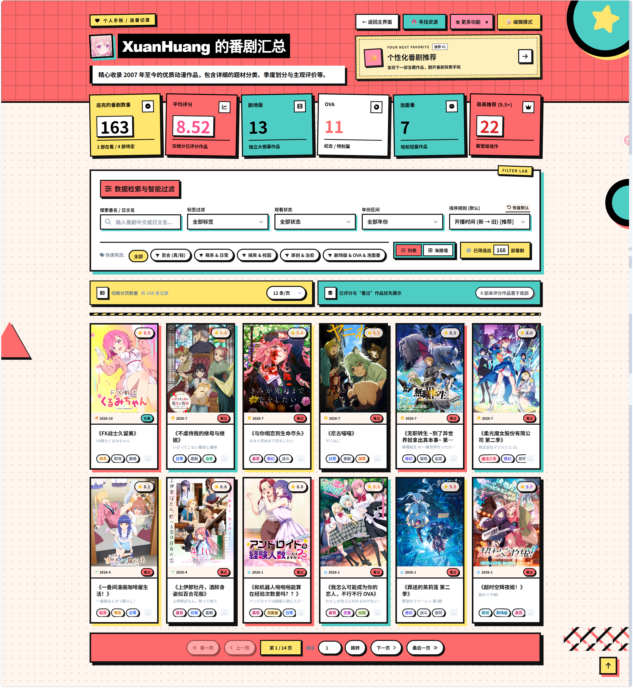
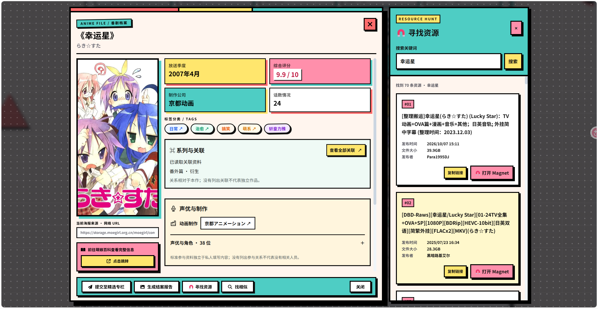
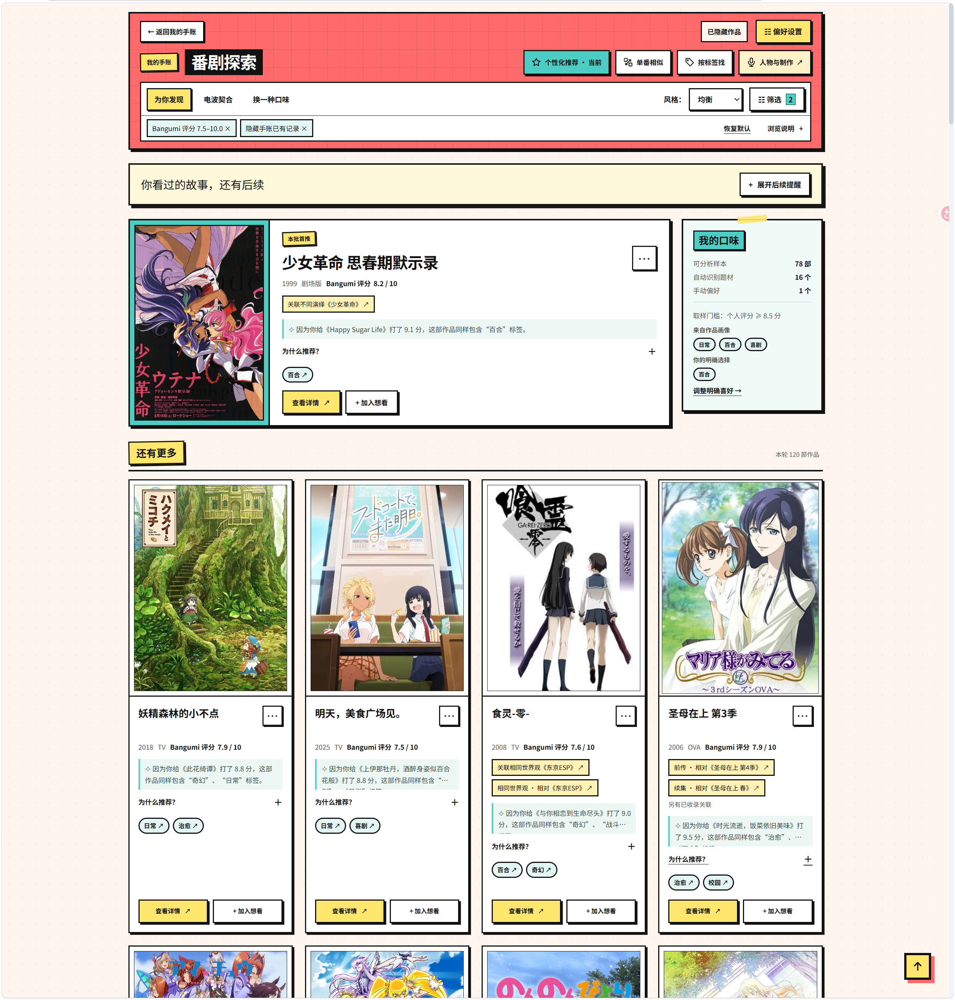
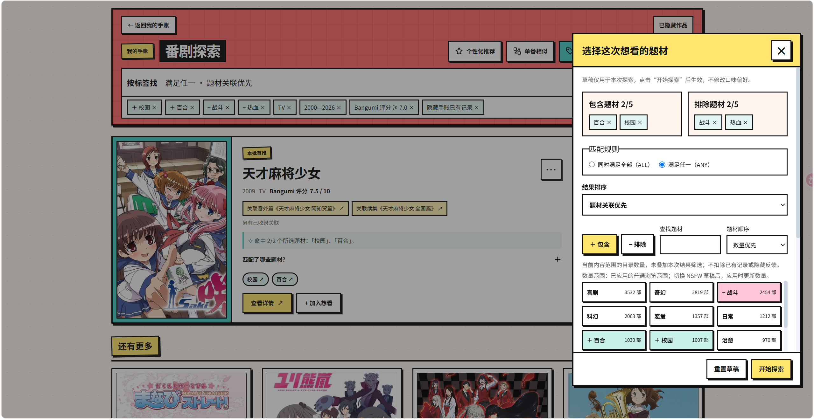
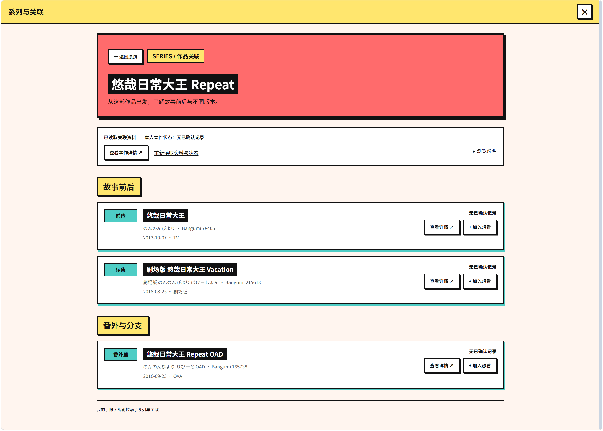
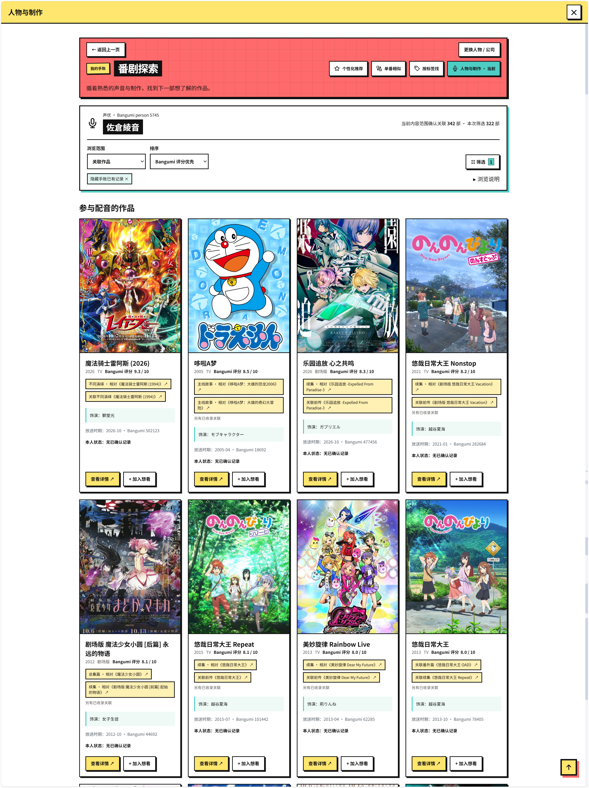
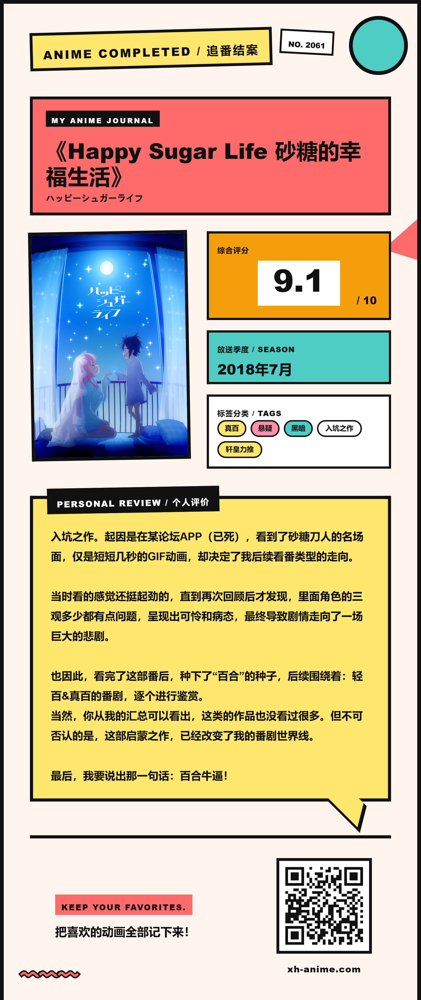

<div align="center">


# Anime Dashboard · 番剧探索手账

**把喜欢的作品留在手账里，把下一次心动交给探索。**

私人评分与长评 · 个性化推荐 · 系列关联 · 声优与制作 · 手账分享

<a href="https://xh-anime.com"></a>


[立即体验](https://xh-anime.com) · [功能一览](#功能一览) · [界面预览](#界面预览) · [本地开发](#本地开发) · [反馈建议](https://github.com/XuanHuang174/Anime-Dashboard/issues)

</div>

<p align="center">
  
</p>

> 注意：如果你访问后没有显示数据或者加载失败，只需等待 30s 左右，再次刷新网页即可正常。<br />
（Render冷启动机制）

## 不只记住看过什么，也找到下一部想看的作品

你可能已经收藏了很多作品，却还想留下一句自己的评价；也可能刚看完一部喜欢的动画，想找一部题材相近的作品，或者沿着熟悉的声优、制作公司继续探索。

Anime Dashboard 将这些事情放在同一本手账中：记录个人评分、长评与观看进度；从自己的手账出发获取推荐；查看作品前后的系列关系；把喜欢的作品加入想看，再按需要公开分享。

界面采用 **Memphis 风格**：粗线条、明亮色块、便签和硬朗阴影，配合分区入场动画与响应式布局，让整理番剧也有翻阅实体手账的感觉。

## 功能一览

| 你想做的事 | 在这里可以怎样完成 |
| --- | --- |
| 给喜欢的作品留个位置 | 建立私人手账，记录评分、长评、标签、状态和进度 |
| 找到下一部想看的作品 | 使用个性化推荐、单番相似、按标签找三种探索方式 |
| 弄清前作、续作和不同版本 | 查看系列与关联，区分故事前后、番外、总集篇等关系 |
| 追随熟悉的声音与制作 | 搜索声优或制作公司，浏览有来源依据的参与作品 |
| 和别人交换片单灵感 | 浏览精选专栏与番剧共创宇宙，按流程公开自己的手账 |
| 留存自己的整理成果 | 导入 Bangumi 收藏、备份 JSON、导出 CSV、生成结案报告图片 |

## 界面预览

<table>
  <tr>
    <td width="50%" align="center">
      <br />
      <strong>私人手账</strong><br />评分、长评、进度，按自己的方式整理。
    </td>
    <td width="50%" align="center">
      <br />
      <strong>番剧探索 - 个性化推荐</strong><br />从自己的喜欢出发，发现下一部作品。
    </td>
  </tr>
  <tr>
    <td align="center">
      <br />
      <strong>番剧探索 - 精准筛选</strong><br />选定题材组合，寻找这次想看的故事。
    </td>
    <td align="center">
      <br />
      <strong>系列与关联</strong><br />认识故事前后，也分清番外和不同版本。
    </td>
  </tr>
  <tr>
    <td align="center">
      <br />
      <strong>人物与制作</strong><br />循着熟悉的声音与制作继续探索。
    </td>
    <td align="center">
      <br />
      <strong>追番结案报告</strong><br />把一部作品的评分与感想留成图片。
    </td>
  </tr>
</table>

## 从一条记录，到下一次发现

### 📒 先拥有一本自己的私人手账

- **四种观看状态**：想看、在看、看过、搁置；在看作品支持快捷增加观看进度。
- **自己的评价体系**：个人评分、长评、自定义标签和配色，可以与公共作品资料保持独立。
- **便于整理的视图**：列表／网格切换，搜索、年份、状态、标签与排序；常用标签组合可保存为快捷筛选。
- **编辑与预览分开**：编辑时专心维护资料，预览时翻阅作品；按账号记住当前浏览器中上次使用的模式。
- **录入方式灵活**：公共库检索、外部资料辅助录入、手动创建，以及 Bangumi 收藏批量导入。

### ✨ 三种探索方式，沿着不同线索找作品

| 入口 | 适合什么时候使用 |
| --- | --- |
| **个性化推荐** | 没有明确目标，想从自己的手账评分与偏好出发寻找作品 |
| **单番相似** | 刚看完一部喜欢的作品，想沿着它的题材特征继续找 |
| **按标签找** | 已经知道想看什么题材，希望自己组合条件探索 |

推荐会展示可用的评分与题材依据，让你知道作品为什么出现在这里。可以调整推荐风格、筛选类型／年份／Bangumi 评分，也支持自定义评分区间。

对结果不感兴趣时，可以隐藏作品、调整反馈并撤销操作；默认筛选可隐藏手账已有记录。找到喜欢的作品后，直接查看详情或加入想看，已有记录的评分与长评会得到保留。

**个人评分与 Bangumi 公共评分分开呈现。** 题材相近也不代表一定喜欢，最终判断仍然属于你。

### 🧩 系列关系，帮助理解作品之间的连接

在作品详情中直接读取“系列与关联”，再进入完整关联页：

- 按故事前后、番外与分支、总集及其他版本等分组浏览。
- 显示本人已有记录状态，支持继续查看详情和加入想看。
- 单番相似中，将已确认的直接关联与其他相似作品分区展示。
- 个性化推荐中，通过可折叠的后续提醒，发现已记录故事的关联作品。

关系依据已收录来源展示，发行日期与建议观看顺序保持区分；没有列出关联，也不代表作品没有续作。

### 🎙️ 从声优与制作公司，发现另一条探索路径

作品详情同时提供“声优与制作”资料。你可以展开声优与角色清单，或点击动画制作公司，进入相应参与作品列表。

“人物与制作”支持实体检索、关联作品／我看过的切换、排序、侧栏筛选和分页，也接通了系列资料、作品详情与加入想看。

资料明确区分标准来源与私人填写内容，并提示覆盖情况；同名实体和未知参与关系不会仅凭名称强行合并。

### 🌍 分享由自己决定

- **公共主界面**：浏览主理人的番剧汇总与个人评价。
- **精选专栏**：翻阅用户提交并经审核收录的作品评价。
- **番剧共创宇宙**：发现通过审核、主动公开的用户手账。
- **个人分享**：普通账号的手账默认私密；公开手账、专栏投稿与主理人公共库展示分别有相应流程。

### 🧰 数据和日常工具，也一起准备好

- **JSON 导出与恢复**：留存手账备份；导入属于恢复操作，使用前请阅读界面提示并备份当前数据。
- **CSV 导出**：导出当前筛选下的列表，便于自行整理。
- **结案报告图片**：将作品、评分、标签和评价组合成可下载的纪念图片。
- **资源检索抽屉**：在作品上下文中打开检索入口；自部署需配置独立上游服务。
- **更新日邮件提醒**：可订阅在看作品的更新日提示，依赖邮件服务与定时任务配置。
- **账号功能**：注册、邮箱验证、登录与密码找回。

## 第一次使用，可以这样开始

1. 打开 [xh-anime.com](https://xh-anime.com)，先逛逛公共主界面、精选专栏或共创宇宙。
2. 注册并完成邮箱验证，进入自己的私人手账。
3. 添加几部喜欢的作品，或导入 Bangumi 收藏，填写自己的评分与感想。
4. 打开 **番剧探索**：获取个性化推荐，或使用单番相似、标签和人物制作线索。
5. 把心动作品加入想看，继续记录进度与评价；需要分享时，再选择公开方式。

## 常见问题

**一定要有 Bangumi 账号吗？**

不需要。可以手动录入或通过作品检索添加；Bangumi 收藏导入是可选方式。

**新账号没有足够评分，也能用吗？**

可以先添加作品、选择偏好，或从单番相似与按标签找开始。个性化结果取决于可用资料，不要求填写长篇问卷。

**私人评分、长评会自动展示给其他人吗？**

普通账号的私人手账默认不公开。主动公开手账、向精选专栏投稿，以及主理人的公共库展示分别有相应流程；提交前可查看公开提示。

**内容范围可以控制吗？**

默认使用安全范围；包含 NSFW 的浏览由本次范围选择、作品审核及服务开关共同控制。私人推荐的范围选择不等同于公开展示设置。

**克隆仓库后，就有线上完整作品库吗？**

没有。代码、数据库结构与生产数据是分开的。推荐目录、系列与参与资料需要独立准备、导入和验收，功能也有相应配置开关。

## 技术栈

| 层次 | 使用技术 |
| --- | --- |
| 前端 | React 19、Vite 6、React Router、GSAP、Axios、Tailwind CSS |
| 后端 | Django 6、Django REST Framework、Simple JWT |
| 数据库 | 本地 SQLite；生产 PostgreSQL／Neon |
| 管理与媒体 | Django Admin／SimpleUI、django-storages、Cloudflare R2 |
| 图片导出 | html2canvas |

```text
anime/             手账、账号、公开展示、导入导出与资源服务
recommendations/   推荐、题材、身份关联、系列和参与资料
frontend/          React 页面、组件、样式及前端测试
config/            Django 配置与路由
docs/              分阶段设计、数据审计及部署验收说明
scripts/           部署核验、测试环境及发布辅助脚本
```

## 本地开发

<details>
<summary><strong>展开开发环境与启动说明</strong></summary>

以下以 Windows PowerShell 为例，使用 Python 3.13，建议搭配 Node.js 22。请在**新克隆的目录**中准备本地环境；已有部署不要用示例配置覆盖自己的 `.env`。

**1. 获取代码与安装依赖**

```powershell
git clone https://github.com/XuanHuang174/Anime-Dashboard.git
cd Anime-Dashboard
python -m venv .venv
.\.venv\Scripts\python.exe -m pip install -r requirements.txt
```

**2. 创建根目录 `.env`**

下面仅用于本机开发。`DATABASE_URL` 留空使用本地 SQLite；完整可选项见 [.env.example](.env.example)。

```dotenv
DEBUG=True
SECRET_KEY=local-development-only-change-before-deployment
ALLOWED_HOSTS=localhost,127.0.0.1
DATABASE_URL=
FRONTEND_URL=http://localhost:5173
CORS_ALLOWED_ORIGINS=http://localhost:5173,http://127.0.0.1:5173
CSRF_TRUSTED_ORIGINS=http://localhost:5173,http://127.0.0.1:5173
TRANSACTIONAL_EMAIL_PROVIDER=django
EMAIL_BACKEND=django.core.mail.backends.console.EmailBackend
```

注册验证邮件会输出到后端终端。若已有系统级 `DATABASE_URL`，请先确认它指向哪里：进程环境变量优先于 `.env`，迁移前必须确认使用的是自己的本地数据库。

**3. 初始化并启动后端**

```powershell
.\.venv\Scripts\python.exe manage.py migrate
.\.venv\Scripts\python.exe manage.py createsuperuser
.\.venv\Scripts\python.exe manage.py runserver 127.0.0.1:8000
```

**4. 在另一个终端启动前端**

```powershell
cd frontend
npm ci
npm run dev
```

- 用户界面：<http://localhost:5173>
- 管理后台：<http://127.0.0.1:8000/admin/>
- 前端通过 Vite 将 `/api`、`/media` 代理到 Django。
- 后端根路径返回健康检查 JSON；请通过前端开发端口访问用户界面。

**5. 检查与构建**

```powershell
# 项目根目录：显式隔离配置，不读取生产库或 R2。
.\.venv\Scripts\python.exe manage.py check --settings=config.recommendation_test_settings

# frontend 目录
npm test
npm run build
```

SQLite 下的后端回归可以使用隔离配置运行；涉及 PostgreSQL 并发语义的测试另需专用本机测试库，见 [测试配置](config/recommendation_pg_test_settings.py)。不要把测试配置用于生产部署。

</details>

### 可选能力与部署资料

基础手账可以从空数据库开始。推荐、系列和参与资料需按文档独立准备数据并开放对应能力；只打开开关不会自动获得完整目录。

| 能力 | 相关说明 |
| --- | --- |
| 环境、数据库、媒体和邮件 | [.env.example](.env.example)、[Django 配置](config/settings.py) |
| 资源检索服务 | [检索代理与抽屉说明](docs/anime-resource-search.md) |
| 推荐资料与封面准备 | [资料来源](docs/recommendation-data-sources.md)、[入库与封面验收](docs/recommendation-production-checklist.md) |
| 系列资料与发布 | [系列模块方案](docs/recommendations-extension-12-plan.md)、[发布验收](docs/recommendations-12f.md) |
| 声优／制作资料与发布 | [参与资料方案](docs/recommendations-extension-13-plan.md)、[发布验收](docs/recommendations-13f.md) |

`docs/` 中的阶段文档保留了当时的开发与验收状态；具体发布以当前部署配置为准。生产密钥放在服务端环境变量中，不写入仓库或前端 `VITE_*` 配置。

## 之后想做的事

本轮已实现私人手账、三种推荐探索、系列关系与人物制作浏览。下一轮将逐步深化个人记录与观看管理，以下均为**后续计划，尚未实现**：

- [ ] 观看历程与重看记录。
- [ ] 待看计划与观看优先级。
- [ ] 个人月度／年度回顾。
- [ ] 主题片单与私人策展。
- [ ] 导入差异预览、资料整理与同步增强。
- [ ] 创作者档案与关注。

## 反馈与致谢

欢迎通过 [Issues](https://github.com/XuanHuang174/Anime-Dashboard/issues) 提交使用反馈、布局问题和功能建议。描述问题时，附上操作步骤、设备／浏览器和经过遮挡的截图会更有帮助。

- 作品资料与关联信息感谢 [Bangumi](https://bgm.tv/)、[Bangumi Archive](https://github.com/bangumi/Archive) 及 [AniList](https://anilist.co/) 等公开来源。
- 推荐探索的早期产品思路参考了 [Neptune-ux-sys/nep2.0](https://github.com/Neptune-ux-sys/nep2.0)，并围绕私人手账、来源依据与观看闭环继续实现。
- 寻找作品磁链资源Fork了 [naranyinyun/AnimeSearch](https://github.com/naranyinyun/AnimeSearch)，自行部署并且进行了优化。
- 感谢 React、Django、GSAP 及其他依赖项目的维护者。

当前仓库尚未附带 `LICENSE` 文件；如需复用或分发代码，请先与[维护者](https://github.com/XuanHuang174)确认授权方式。

<div align="center">

**发现下一部宝藏作品，翻开番剧探索手账。**

[进入 Anime Dashboard →](https://xh-anime.com)

</div>
